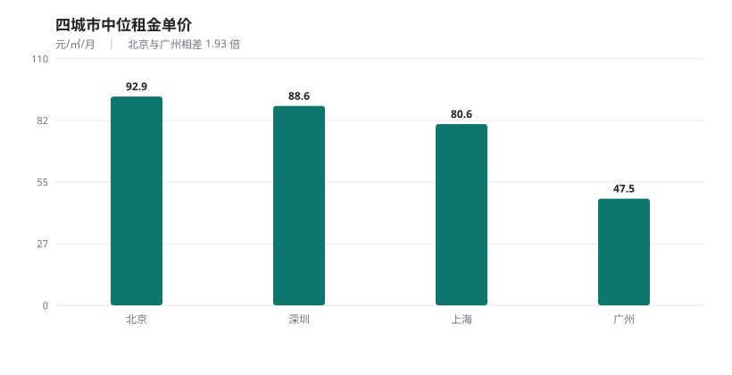
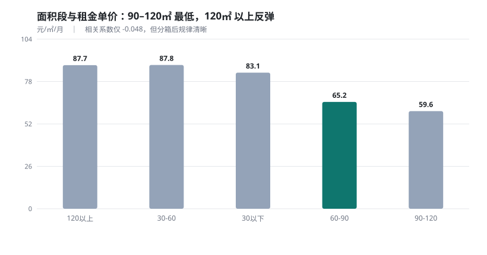

# 城市租房数据集分析

基于北上广深四城 **12,000** 条租房挂牌数据，量化各因素对租金的影响、识别同商圈内的性价比房源，并建立租金预估模型。


> **核心结论**
>
> 1. **城市内部的分化比城市之间更剧烈**——四城租金最高与最低相差 1.93 倍，但同一城市内部区县之间最大相差 **7.3 倍**（上海静安 152.9 vs 广州从化 20.8 元/㎡/月）。判断租金贵不贵，必须先锁定到商圈。
> 2. **面积存在规模效应，但 120㎡ 以上失效**——面积弹性 **0.854**（面积涨 1%，租金只涨 0.85%），90–120㎡ 单位成本最低（59.6 元/㎡/月）；但超过 120㎡ 单价反弹至 87.7，说明大户型里混着高单价豪宅。
> 3. **控制区位后，多一个卫生间溢价 14.8%、精装溢价 14.2%、距地铁每远 1 公里租金降 9.7%**。而"朝南"系数为 -3.7%——这是遗漏变量（房龄）造成的假象，不是"朝南不值钱"。
> 4. 仅凭公开属性可解释约 **78%** 的租金波动（测试集 R² = 0.776，MAE 1,846 元）。

---

## 目录

- [项目背景](#项目背景)
- [分析框架](#分析框架)
- [数据说明](#数据说明)
- [三个数据陷阱](#三个数据陷阱)
- [核心发现](#核心发现)
- [模型结果](#模型结果)
- [项目结构](#项目结构)
- [快速开始](#快速开始)
- [局限性](#局限性)

---

## 项目背景

城市租房市场的信息分散且不透明。租金受区位、面积、户型、装修、朝向、通勤等多重因素影响，但市场缺乏公开、量化的定价参照。

这造成三方困境：

- **租客**只能凭经验横向比价，难以判断一套房源是"贵"还是"正常"；
- **房东与中介**缺少定价依据，挂高则空置周期拉长，挂低则损失收益；
- **平台运营**缺少可度量房源价格合理性的指标体系，无法做房源分层。

本项目用数据分析方法，把"租金是否合理"这一经验判断，转化为可量化、可验证的指标与模型。

## 分析框架

| 层级 | 问题 | 方法 | 产出 |
|---|---|---|---|
| 描述 | 租金的空间格局如何？ | 分城市 / 区县 / 商圈聚合 | 租金梯度排名、价格带 |
| 诊断 | 哪些属性影响租金最显著？ | 多元回归 + 系数标准化排序 | 溢价幅度（百分比） |
| 诊断 | 面积与单价是什么关系？ | 分箱统计 + 面积弹性 | 性价比最优面积区间 |
| 诊断 | 如何在同商圈内识别性价比房源？ | P25–P75 价格带 + 模型残差 | 折价房源候选 |
| 预测 | 能否预估合理租金区间？ | log 尺度多元回归 | R² / MAE / 误差区间 |

## 数据说明

| 项目 | 内容 |
|---|---|
| 来源 | 和鲸社区「北上广深链家网全部租房房源数据」（CC0），原始出处 [Alfred1984/interesting-python](https://github.com/Alfred1984/interesting-python/tree/master/BSGS_Rent) |
| 覆盖 | 北京 / 上海 / 广州 / 深圳，各 3,000 条 |
| 规模 | 原始 **12,000** 条 → 清洗后 **10,722** 条（保留 **89.3%**）→ 建模 **10,383** 条 |
| 数据时点 | 2020 年 8 月 |
| 字段数 | 20 |

**处理流程**：列名标准化 → 类型解析 → 双层去重 → 分级缺失处理 → 分组异常值过滤 → 派生特征。每步删除量与原因见 [`data/cleaning_log.csv`](data/cleaning_log.csv)。

> **时效说明**：数据采集于 2020 年 8 月。本报告定位为**历史快照分析**，反映当时的价格结构，不用于判断当下市场水平。价格**结构关系**（哪些因素影响租金、影响方向）比绝对水平更稳定，也是本项目的关注重点。

> **合规声明**：数据仅用于学习研究与作品展示，不用于商业用途，不对外分发原始明细。不含任何个人身份信息。

## 三个数据陷阱

这份数据有三个不处理就会得出错误结论的地方，也是本项目最花功夫的部分：

**① 合租与整租的面积口径不同**

合租填的是**单间**面积与价格（中位 13㎡ / 154.5 元），整租是整套（78㎡ / 75.3 元）。不加区分直接算单价，会得出"合租比整租贵一倍"的荒谬结论——这不是市场规律，是口径问题。已标记 `is_shared` 并在单价分析中排除。

**② 装修信息藏在标签串里**

没有独立装修列，只在 `house_tag` 里（`精装 集中供暖 双卫生间`），且只有 23% 的房源标了"精装"。其余不是"毛坯"，而是**未标注**——房东没填不等于没装修，不能合并。

**③ 朝向是多值组合**

96 种取值（`南`、`南 北`、`东南 西南 西 东北`…）。归并为"是否朝南"时有个坑：用 `contains("南")` 会把「东南」「西南」误判成朝南，必须匹配独立的「南」字。

## 核心发现

### 城市与区县梯度

| 城市 | 房源数 | 中位单价 | 中位租金 | 中位面积 |
|---|---|---|---|---|
| 北京 | 2,745 | 92.9 | 6,500 | 77 |
| 深圳 | 2,572 | 92.8 | 4,380 | 51 |
| 上海 | 2,767 | 80.5 | 6,000 | 89 |
| 广州 | 2,638 | 48.2 | 3,200 | 75 |

深圳与北京单价几乎持平，但中位面积只有 51㎡——**深圳是"单价高、总价低"的结构**。




区县层面，静安（152.9）与从化（20.8）相差 **7.3 倍**，远超城市间的 1.93 倍。

### 面积与单价：非线性且不单调

| 面积段 | 房源数 | 中位单价 |
|---|---|---|
| 30㎡ 以下 | 1,156 | 98.8 |
| 30–60 | 2,810 | 87.8 |
| 60–90 | 3,090 | 65.3 |
| 90–120 | 1,817 | **59.6** |
| 120㎡ 以上 | 1,849 | 87.7 |

面积与单价的皮尔逊相关系数只有 **-0.048**，几乎为零——容易误判成"面积不影响单价"。但分箱后规律清晰：**90–120㎡ 单位成本最低，120㎡ 以上因混入豪宅而反弹**。相关系数接近零，正是两端方向相反互相抵消的结果。




## 模型结果

对 `log(租金)` 做多元线性回归（最小二乘）：

| 指标 | 数值 |
|---|---|
| 测试集 R² | **0.7761** |
| 测试集 MAE | 1,846 元/月 |
| 测试集 MAPE | 30.2% |
| 特征维度 | 39 |

| 变量 | 效应（相对基准组） |
|---|---|
| 面积弹性 | 0.854 |
| 卫生间数 | +14.8% / 每个 |
| 精装 | +14.2% |
| 地铁距离 | -9.7% / 每公里 |
| 朝南 | -3.7%（遗漏变量所致，非因果） |

**关于不使用随机森林**：本次分析环境只有 pandas + numpy。线性回归的系数能直接翻译成"精装贵 14%"，树模型的特征重要性做不到这一点。与其堆跑不起来的模型，不如把可解释的回归做扎实。

## 项目结构

```
.
├── README.md
├── report.md                  # 完整分析报告
├── cleaning_eda.py            # 数据清洗 + 探索性分析
├── modelling.py               # 特征工程 + 回归建模 + 残差诊断
├── data/
│   ├── sample_rent.csv        # 示例数据
│   ├── cleaning_log.csv       # 清洗对账表（运行后生成）
│   └── model_results.csv      # 回归系数明细（运行后生成）
├── fig/                       # 图表
└── requirements.txt
```

## 快速开始

```bash
pip install -r requirements.txt

# 数据体检（先看数据长什么样）
python cleaning_eda.py --in data/rent_raw.csv --inspect

# 清洗 + EDA
python cleaning_eda.py --in data/rent_raw.csv

# 建模
python modelling.py
```

## 局限性

- **数据时效**：采集于 2020 年 8 月，绝对租金水平已失效，只强调价格结构关系。
- **价格口径**：挂牌价不等于成交价，存在议价空间，结论侧重相对比较。
- **变量完整性**：缺房龄、采光、学区等关键因素，存在遗漏变量偏误（朝南系数为负即为此例），系数只能解释为相关关系。
- **样本偏差**：平台房源以中介代理为主，个人直租少。
- **数据规模**：1.2 万条，单机可处理，不构成严格意义的"大数据"场景。

---

完整分析过程与结论见 **[report.md](report.md)**。
