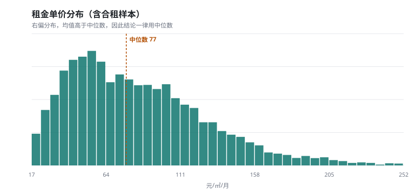
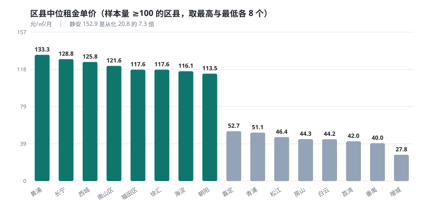
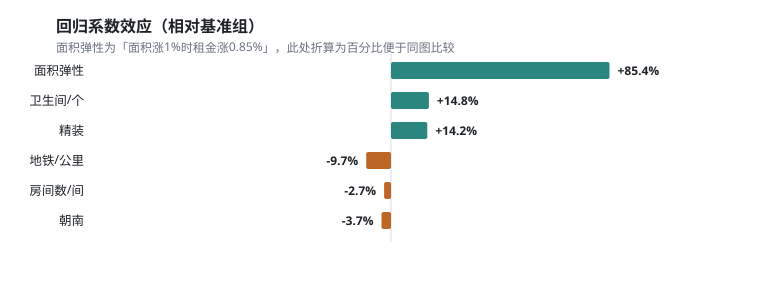

# 城市租房数据集分析报告

**分析对象**：北上广深四城 12,000 条租房挂牌数据　|　**数据时点**：2020-08

---

## 摘要

本报告基于北上广深四个一线城市共 **12,000** 条租房挂牌数据（清洗后保留 **10,722** 条），回答两个问题：租金由什么决定，以及如何判断一套房源定价是否合理。

四个主要结论：

1. **城市间的租金差距小于城市内部的区县差距**。四城中位租金单价最高与最低相差 1.93 倍（北京 92.9 vs 广州 48.2 元/㎡/月），但同一城市内部区县之间最大相差 **7.3 倍**（上海静安 152.9 vs 广州从化 20.8）。区位是比"城市"更细、也更有解释力的切面。
2. **面积对租金的影响存在规模效应，但不单调**。面积弹性为 **0.854**——面积每增加 1%，租金只增加 0.85%，说明大房子的单位面积更便宜。但分箱后 120㎡ 以上的单价回升至 87.7 元，高于 90–120㎡ 的 59.6，说明大户型里混着高单价豪宅，不能用一条递减曲线概括。
3. **控制区位后，多一个卫生间溢价 14.8%，精装溢价 14.2%，距地铁每远 1 公里租金降 9.7%**。而"朝南"的系数为 **-3.7%**，与直觉相反——这是遗漏变量（房龄）的典型表现，不能解读为"朝南不值钱"。
4. **仅凭公开的房源属性可解释约 78% 的租金波动**（测试集 R² = 0.776），剩余部分由房龄、采光、装修细节、房东心态等未观测因素决定。

---

## 目录

1. [项目背景](#1-项目背景)
2. [数据说明](#2-数据说明)
3. [数据清洗](#3-数据清洗)
4. [探索性分析](#4-探索性分析)
5. [建模与验证](#5-建模与验证)
6. [结论与建议](#6-结论与建议)
7. [局限性](#7-局限性)
8. [附录](#8-附录)

---

## 1. 项目背景

城市租房市场的信息长期分散且不透明。租金受区位、面积、户型、装修、朝向、通勤等多重因素影响，但市场缺乏公开、量化、可复现的定价参照体系。

由此产生三方困境：

| 角色 | 困境 | 需要什么 |
|---|---|---|
| 租客 | 无法判断价格是否合理，只能凭经验横向比价 | 同区位同类型的价格参照 |
| 房东 / 中介 | 缺少定价依据，挂高空置、挂低损失 | 属性对租金的量化影响 |
| 平台运营 | 缺少房源价格合理性的度量指标 | 可自动化的价格异常识别规则 |

**分析目标**：把"租金是否合理"这一经验判断，转化为可量化、可验证的指标与模型。

### 1.3 选题考量

这个项目在动手前，先按四条标准筛选题目：

| 标准 | 为什么重要 | 租房数据的符合情况 |
|---|---|---|
| **数据能合法获取** | 学生项目最容易卡在第一步就踩红线 | 链家自身 robots 为 `User-agent: *` + `Disallow: /*`，全站禁止普通爬虫；因此改用社区公开的 CC0 数据集 |
| **字段结构能支撑完整链路** | 只有两列数字的数据，做不出特征工程与建模 | 20 个字段中数值、类别、文本三类齐全 |
| **有真实业务场景** | 没有场景的分析只是练习题 | 租客比价、房东定价、平台价格异常识别，三方需求明确 |
| **数据规模与方法匹配** | 太大需引入分布式，太小做不出统计结论 | 1.2 万条：统计上足够，单机可在秒级完成，无需 Spark |

此外还有一条容易被忽略的考量：**沟通成本**。「南山区比龙岗区贵一倍」这类结论不需要行业背景就能听懂，讲述与评审的成本都更低。

选题过程中也排除了两类方向：一是自建爬虫采集（目标站点协议禁止），二是纯文本类分析（与数据分析岗的匹配度低于结构化数据）。最终留下的题目，是四条标准共同筛出的结果。

---

## 2. 数据说明

### 2.1 数据来源

| 项目 | 内容 |
|---|---|
| 来源 | 和鲸社区「北上广深链家网全部租房房源数据」，原始出处 [Alfred1984/interesting-python](https://github.com/Alfred1984/interesting-python/tree/master/BSGS_Rent) |
| 许可 | CC0 公共领域共享 |
| 覆盖 | 北京 / 上海 / 广州 / 深圳，各 3,000 条 |
| 数据时点 | 2020 年 8 月 |
| 字段数 | 20 |

> **合规声明**：数据仅用于学习研究与作品展示，不用于商业用途，不对外分发原始明细。数据不含任何个人身份信息。

> **时效说明**：数据采集于 2020 年 8 月，距今已有数年。因此本报告定位为**历史快照分析**，结论反映的是当时的价格结构，不用于判断当下市场水平。价格**结构关系**（哪些因素影响租金、影响方向）比绝对水平更稳定，也是本报告的主要关注点。

### 2.2 字段说明

| 原始字段 | 含义 | 类型 |
|---|---|---|
| `_id` | 房源唯一编号 | string |
| `city` / `dist` | 城市 / 区县 | string |
| `bizcircle_name` | 商圈 | string |
| `resblock_name` | 小区名 | string |
| `rent_price_listing` | 月租金（元） | **原始为字符串** |
| `rent_area` | 面积（㎡） | **原始为字符串** |
| `layout` | 户型，如 `3室2厅2卫` | string |
| `frame_orientation` | 朝向，多值为组合（如 `南 北`） | string |
| `house_tag` | 标签，如 `精装 集中供暖 双卫生间` | string |
| `distance` | 距地铁距离（米），缺失 43.4% | float |
| `type` | 整租 / 合租 | string |
| `latitude` / `longitude` | 经纬度 | float |

### 2.3 数据质量的四个关键问题

这份数据有几个必须处理、且会直接影响结论的问题：

| 问题 | 表现 | 处理 |
|---|---|---|
| 数值存成字符串 | `rent_price_listing`、`rent_area` 是文本，无法直接计算 | 正则抽取数字，解析失败置空 |
| 装修信息无独立列 | 装修只藏在 `house_tag` 里（`精装 集中供暖…`） | 从标签派生，只分「精装 / 未标注」 |
| **合租与整租口径不同** | 合租填的是**单间**面积与价格（中位 13㎡ / 154.5 元），整租是整套（78㎡ / 75.3 元） | 标记 `is_shared`，单价分析排除合租 |
| 朝向是多值组合 | 96 种取值（`南`、`南 北`、`东南 西南 西 东北`…），直接分组无意义 | 归并为「是否朝南」布尔字段 |

> **第 3 条是本数据最大的陷阱。** 如果不加区分直接算单价，会得出"合租比整租贵一倍"的荒谬结论——合租单价高不是市场规律，而是面积口径不同。
>
> **第 4 条有个容易犯的错**：用 `contains("南")` 判断朝南，会把「东南」「西南」也误判为朝南。必须匹配独立的「南」字（`(?:^\|\s)南(?:\s\|$)`）。

---

## 3. 数据清洗

### 3.1 清洗顺序

清洗顺序影响结果，固定为六步：

1. **列名标准化** — 后续逻辑依赖标准名
2. **类型解析** — 必须早于去重（`89` 与 `89.0` 在字符串里是不同值）
3. **双层去重** — 完全重复 + 业务键重复
4. **缺失值分级处理** — 必须在分位数计算之前（NaN 会污染阈值）
5. **异常值分组过滤** — 用干净数据算分位
6. **派生特征** — 依赖清洗后的数值

### 3.2 清洗对账

| 步骤 | 清洗前 | 清洗后 | 剔除 | 说明 |
|---|---|---|---|---|
| 类型解析 | 12,000 | 12,000 | 0 | 全部成功解析为数值 |
| 去重（完全重复） | 12,000 | 12,000 | 0 | 无翻页重叠 |
| 去重（业务键） | 12,000 | 11,544 | **456** | 键 = 小区+面积+户型+租金 |
| 缺失值处理 | 11,544 | 11,544 | 0 | 核心字段无缺失 |
| 异常值（硬规则） | 11,544 | 11,544 | 0 | 无非法值 |
| 异常值（分位） | 11,544 | **10,722** | **822** | 按商圈 1%/99% 分位 |
| **合计** | **12,000** | **10,722** | **1,278** | 保留率 **89.3%** |

完整日志见 [`data/cleaning_log.csv`](data/cleaning_log.csv)。

### 3.3 两个非标准处理

**① 异常值按商圈分组，不用全城口径**

核心地段的大户型高价房，在全城分布里是极端值，但按它所在商圈看完全合理。因此按商圈分组算 1% / 99% 分位，样本量少于 10 条的商圈退回全城口径。若用全城口径，删掉的多半是真实的高价房源，结论会系统性偏向低价房。

用分位而非 3σ 的理由：租金是右偏分布（偏度 4.41），标准差被长尾撑大，3σ 会同时放过异常值、误伤正常贵房源。

**② 缺失率高的字段不一律丢弃**

`distance`（地铁距离）缺失 43.4%，按默认阈值（30%）会被整列丢弃。但这个字段的缺失往往表示"小区附近没有地铁站"，本身就是信息，不是数据丢失。因此对这类字段做**豁免**，保留并在建模时额外加一个「缺失标记」列。

---

## 4. 探索性分析

### 4.1 单变量分布

| 指标 | 均值 | 中位数 | 标准差 | 偏度 | 变异系数 |
|---|---|---|---|---|---|
| 月租金（元） | 7,093 | **5,000** | 7,369 | 4.41 | 1.04 |
| 面积（㎡） | 85.0 | **76.0** | 57.1 | 2.59 | 0.67 |
| 租金单价（元/㎡/月） | 84.9 | **76.9** | 45.3 | 1.18 | 0.53 |

三个指标全部右偏，租金尤其明显（偏度 4.41，最高 16 万元/月）。




**业务含义**：均值被少量高价房源拉高——租金均值 7,093 元，但中位数只有 5,000 元，均值比中位数高 42%。**报告中必须报中位数**，否则会系统性高估普通租客的实际负担。

### 4.2 城市与区县梯度

**城市层**

| 城市 | 房源数 | 中位单价 | 中位租金 | 中位面积 |
|---|---|---|---|---|
| 北京 | 2,745 | **92.9** | 6,500 | 77.0 |
| 深圳 | 2,572 | 92.8 | 4,380 | 51.0 |
| 上海 | 2,767 | 80.5 | 6,000 | 89.0 |
| 广州 | 2,638 | **48.2** | 3,200 | 75.0 |

北京与广州相差 **1.93 倍**。


值得注意：深圳的中位单价与北京几乎持平（92.8 vs 92.9），但中位**面积只有 51㎡**（北京 77㎡），中位租金 4,380 元也明显低于北京的 6,500 元。**深圳是"单价高、总价低"的结构**——房间小，但每平米贵。

**区县层**

| 区县 | 城市 | 房源数 | 中位单价 | 离散度 |
|---|---|---|---|---|
| 静安 | 上海 | 84 | **152.9** | 0.19 |
| 黄浦 | 上海 | 100 | 133.3 | 0.26 |
| 福田区 | 深圳 | 454 | 129.0 | 0.36 |
| 长宁 | 上海 | 162 | 128.8 | 0.24 |
| 南山区 | 深圳 | 553 | 126.0 | 0.36 |
| 朝阳 | 北京 | 953 | 113.5 | 0.30 |
| 浦东 | 上海 | 745 | 81.6 | 0.46 |
| 白云 | 广州 | 593 | 44.4 | 0.43 |
| 番禺 | 广州 | 491 | 40.0 | 0.34 |
| 从化 | 广州 | 13 | **20.8** | 0.26 |

最高（静安）与最低（从化）相差 **7.3 倍**，远超城市间的 1.93 倍。




**业务含义**：**"哪个城市的租金贵"是个伪问题，真正该问的是"哪个区县、哪个商圈"。** 城市内部的分化比城市之间更剧烈。另外，浦东的离散度 0.46 是样本量较大区县里最高的——说明浦东内部分化极大，只看区均值会严重掩盖板块差异（陆家嘴和临港不是一个世界）。

### 4.3 商圈价格带

样本量 ≥ 10 的商圈共 346 个，中位单价最高的几个：

| 商圈 | 城市 | 房源数 | 中位单价 | P25 | P75 |
|---|---|---|---|---|---|
| 新天地 | 上海 | 13 | 195.9 | 150.5 | 232.9 |
| 衡山路 | 上海 | 19 | 193.2 | 179.5 | 207.9 |
| 东大桥 | 北京 | 11 | 188.9 | 169.1 | 210.1 |
| 深圳湾 | 深圳 | 28 | 188.6 | 156.6 | 215.2 |
| CBD | 北京 | 11 | 184.0 | 130.7 | 203.2 |
| 金融街 | 北京 | 18 | 182.4 | 161.0 | 200.8 |

**业务含义**：商圈的 P25–P75 区间就是该片区的"合理价格带"。低于 P25 的房源即为折价候选，高于 P75 则为明显溢价。这是后面性价比识别的方法基础。

### 4.4 属性与单价的关系

| 属性 | 分组 | 房源数 | 中位单价 | 占比 |
|---|---|---|---|---|
| 装修 | 精装 | 2,465 | **107.1** | 23.0% |
| | 未标注 | 8,257 | 68.8 | 77.0% |
| 朝向 | 含独立「南」 | 6,706 | 75.0 | 62.5% |
| | 不含「南」 | 3,900 | 80.9 | 36.4% |
| 租赁类型 | 整租 | 10,383 | 75.3 | 96.8% |
| | 合租 | 339 | 154.5 | 3.2% |

**三个必须谨慎解读的陷阱**：

1. **精装的高单价有一半是区位带来的。** 精装房源中位单价 107.1，比未标注高 55.8%，但精装房很可能集中在核心区。控制变量后的真实溢价是 **14.2%**（见 5.2 节），不到表面差异的三分之一。
2. **朝南的单价反而更低（75.0 vs 80.9）。** 这与"朝南应该更贵"的直觉相反。原因是「南 北」这种南北通透的房源多为房龄较长的老小区，而房龄不在数据里。**这是遗漏变量造成的假象，不能得出"朝南不值钱"的结论。**
3. **合租单价 154.5 是整租的两倍多，但这是口径问题。** 合租的中位面积只有 13㎡，填的是单间面积。两者的单价完全不可比。

### 4.5 面积与单价：非线性，且不单调

面积与租金单价的皮尔逊相关系数仅 **-0.048**——几乎没有线性关系。这容易让人得出"面积不影响单价"的错误结论。

但按面积分箱后，模式很清晰：

| 面积段 | 房源数 | 中位单价 | 趋势 |
|---|---|---|---|
| 30㎡ 以下 | 1,156 | **98.8** | 小户型单价最高 |
| 30–60 | 2,810 | 87.8 | ↓ |
| 60–90 | 3,090 | 65.3 | ↓ |
| 90–120 | 1,817 | 59.6 | 最低点 |
| 120㎡ 以上 | 1,849 | **87.7** | **反弹** |


**业务含义**：

- 从 30㎡ 到 120㎡，单价从 98.8 一路降到 59.6，**规模效应成立**——面积越大，单位面积越便宜。这与回归得到的面积弹性 0.854（小于 1）一致。
- **但 120㎡ 以上单价反弹到 87.7，打破了这一规律。** 说明大户型里混着高单价豪宅（高端改善型房源），不是单纯的"越大越便宜"。
- 所以"面积越大单价越低"这个说法只在 120㎡ 以内成立。**相关系数 -0.048 之所以接近零，正是因为两端方向相反、互相抵消。**

**对租客的直接含义**：**90–120㎡ 是单位成本最低的区间**（59.6 元/㎡/月）。如果考虑合租或整租分摊，这个面积段的人均成本最优。

---

## 5. 建模与验证

### 5.1 模型选择

对 `log(租金)` 做多元线性回归，方法是最小二乘（`numpy.linalg.lstsq`）。

**为什么用 log 而不是原始租金**：租金右偏（偏度 4.41），取对数后分布接近正态，残差更符合回归假设；且系数可以直接解释为**百分比变化**（`exp(β) - 1`），比原始尺度的系数更好用。

**为什么不用随机森林**：本次分析环境只有 pandas + numpy，无 sklearn。与其堆一个跑不起来的树模型，不如把一个能跑通、系数可解释的回归做扎实。线性回归的系数能直接翻译成"带电梯贵 14%"，树模型的特征重要性做不到这一点。

**特征**：`log(面积)`、房间数、厅数、卫生间数、地铁距离（含缺失标记）、装修、朝向、区县（39 维）。

> **一个必须避免的错误**：不要同时把 `city` 和 `district` 放进模型。区县从属于城市，两者高度共线，同时放入会让系数互相抢解释力——实测会出现"北京比上海低 25%"这种与描述统计（北京 92.9 > 上海 80.5）直接矛盾的系数。本模型保留 `district`（粒度更细），城市差异用 4.2 节的分组统计呈现。

### 5.2 评估结果

| 指标 | 数值 |
|---|---|
| 训练集 R² | 0.7798 |
| **测试集 R²** | **0.7761** |
| 测试集 MAE | **1,846 元/月** |
| 测试集 MAPE | 30.2% |
| 建模样本 | 10,383 条（排除合租 339 条） |

**如何解读 0.776**：住房租金的截面数据，R² 在 0.6–0.8 属于正常区间，因为房龄、采光、装修细节、房东心态、议价空间等大量因素不在数据里。训练集与测试集 R² 只差 0.004，说明**没有明显过拟合**。

但 MAPE 30.2% 说明点预测不够准——**这是本模型的实际边界**。所以下面的结论都用"区间"和"相对比较"表述，不做精确点估计。

### 5.3 回归系数（真实溢价幅度）

**基准组**：区县 = 丰台，装修 = 未标注，朝向 = 不含南。

| 变量 | 系数效应 | 解读 |
|---|---|---|
| **面积弹性** | **0.854** | 面积每增 1%，租金增 0.85%（弹性 < 1 = 规模效应） |
| 卫生间数 | **+14.8%** / 每个 | 控制面积后，多一个卫生间贵 14.8% |
| **精装** | **+14.2%** | 相对未标注（不是相对毛坯） |
| 地铁距离 | **-9.7%** / 每公里 | 每远离地铁 1 公里，租金降 9.7% |
| 房间数 | -2.7% / 每间 | 面积固定时，房间越多每间越小，总租金反而略低 |
| 厅数 | -0.2% | 无显著影响 |
| 朝南 | -3.7% | **反直觉，见下方说明** |

**区县效应**（相对丰台）：长宁 **+52.3%**、黄浦 +51.5%、西城 +47.0%、南山区 +43.9%；增城 **-63.5%**、番禺 -52.6%、荔湾 -50.7%、白云 -47.1%。




**关于"朝南 -3.7%"这个反直觉结果**：控制区县、面积、户型之后，朝南系数为负。这**不能**解读为"朝南不值钱"。可能的原因是：数据里朝南的房源占 62.5%，其中大量是「南北通透」的老小区房源，而**房龄这个关键变量不在数据中**。房龄老 → 单价低 → 被错误地归因到"朝南"上。

这是**遗漏变量偏误**的教科书案例。它同时也是本模型最大的局限：所有系数只能解释为**相关关系**，不能当作因果结论。

### 5.4 特征影响力排序

按标准化系数绝对值（消除量纲影响后可比）排序，前几位：

| 排序 | 特征 | 影响力 | 方向 |
|---|---|---|---|
| 1 | log(面积) | 0.489 | 正向 |
| 2 | 区县·南山区 | 0.169 | 正向 |
| 3 | 区县·天河 | 0.143 | 正向 |
| 4 | 区县·福田区 | 0.138 | 正向 |
| 5 | 区县·松江 | -0.130 | 负向 |
| 6 | 区县·越秀 | 0.129 | 正向 |
| 7 | 卫生间数 | 0.093 | 正向 |

**业务含义**：面积是单一影响最大的变量，但**区位（区县）作为一个整体，影响力超过面积**——前 7 位里有 5 个是区县虚拟变量。这与 4.2 节的描述统计结论一致：区位是租金的第一解释变量。

### 5.5 残差诊断

模型误差最大的样本集中在两类：

- **高估**（实际租金远低于预测）：挂牌价明显偏高的房源，或存在硬伤（临街、采光差）但数据中没有体现。
- **低估**（实际租金远高于预测）：高端装修、特殊景观（江景、学区）的房源，这些溢价因素不在字段里。

**业务含义**：残差偏离超过 ±30% 的房源，恰恰是**价格异常识别规则**的候选——要么是钓鱼盘、要么有未披露的硬伤、要么是被低估的好房源。这把模型误差从"缺点"变成了"筛选工具"。

---

## 6. 结论与建议

### 6.1 核心结论

1. **区位是第一解释变量，且粒度越细越有效。** 城市间差 1.93 倍，区县间差 7.3 倍。判断租金贵不贵，必须先锁定到商圈。
2. **面积存在规模效应，但 120㎡ 以上失效。** 面积弹性 0.854，90–120㎡ 单位成本最低（59.6 元/㎡/月），超过 120㎡ 单价反弹至 87.7。
3. **控制区位后，功能性属性（卫生间、装修）和通勤属性（地铁距离）才是真正的溢价来源**：多一个卫生间 +14.8%，精装 +14.2%，距地铁每公里 -9.7%。
4. **公开属性可解释约 78% 的租金波动**，剩下 22% 由房龄、采光、议价空间等未观测因素决定。

### 6.2 分角色建议

| 角色 | 建议 | 依据 |
|---|---|---|
| **租客** | 先锁定商圈，用该商圈 P25–P75 价格带作为比价基准；低于 P25 的房源优先看 | 4.3 节 |
| **租客** | 若追求单位面积成本最低，选 90–120㎡ 区间；若只求总价低，30㎡ 以下小户型单价虽高但总价低 | 4.5 节 |
| **租客** | 同一套房源，距地铁每远 1 公里可要求约 10% 的价格让步 | 5.3 节 |
| **房东 / 中介** | 挂牌定价 = 所在商圈中位单价 × 面积 × (1 + 装修调整 14% + 卫生间调整 15% × 个数) | 5.3 节 |
| **平台运营** | 用模型残差作为价格异常识别规则：残差偏离超过 ±30% 的房源进入人工复核队列 | 5.5 节 |

---

## 7. 局限性

| 维度 | 局限 | 影响 | 应对 |
|---|---|---|---|
| **数据时效** | 采集于 2020 年 8 月，距今数年 | 绝对租金水平已失效 | 定位为历史快照分析；只强调价格**结构**关系，不判断当下水平 |
| **价格口径** | 挂牌价 ≠ 成交价，存在议价空间 | 绝对租金偏高；溢价幅度估计有偏 | 全部表述为"挂牌租金"；结论侧重相对比较 |
| **变量完整性** | 缺房龄、采光、学区、装修细节、物业品质 | **遗漏变量偏误**（朝南系数为负即为此例） | 声明为相关关系；用残差分析标注未解释部分的来源 |
| **样本偏差** | 链家平台房源以中介代理为主，个人直租少 | 可能系统性偏向某一类房源 | 明确标注来源；不外推至全部租房市场 |
| **每城 3000 条** | 每城市固定采样，非全量 | 小商圈样本量不足，价格带不稳定 | 商圈分析设样本量门槛（≥10 条） |
| **模型能力** | 单一时点截面，未做时空交叉验证 | 跨时间泛化能力未验证 | 定位为预估基线；用误差区间代替点估计 |
| **数据规模** | 1.2 万条，单机可处理 | 不构成严格意义的"大数据"场景 | 如实说明量级判断，分布式实现仅作扩展 |

---

## 8. 附录

### 8.1 代码结构

| 文件 | 职责 |
|---|---|
| `cleaning_eda.py` | 清洗流水线 + 探索性分析 |
| `modelling.py` | 特征工程 + 回归建模 + 评估 + 残差诊断 |
| `data/cleaning_log.csv` | 清洗对账表 |
| `data/model_results.csv` | 回归系数明细 |

### 8.2 复现步骤

```bash
# 1. 数据体检
python cleaning_eda.py --in data/rent_raw.csv --inspect

# 2. 清洗 + EDA（输出 clean.csv / 日志 / 图表）
python cleaning_eda.py --in data/rent_raw.csv

# 3. 建模
python modelling.py
```

### 8.3 环境

- Python 3.7+
- pandas 1.3+、numpy 1.21+
- 图表：matplotlib（可选，缺失时自动跳过绘图）

---

*本报告数据仅用于学习研究，不用于商业用途。*
